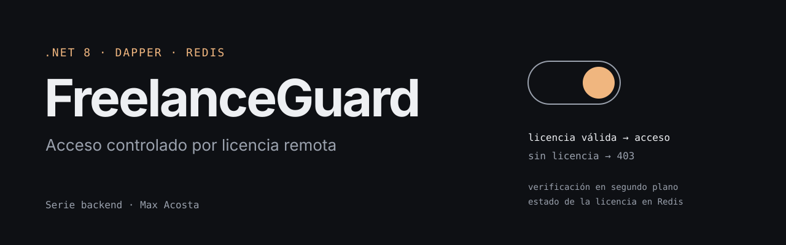
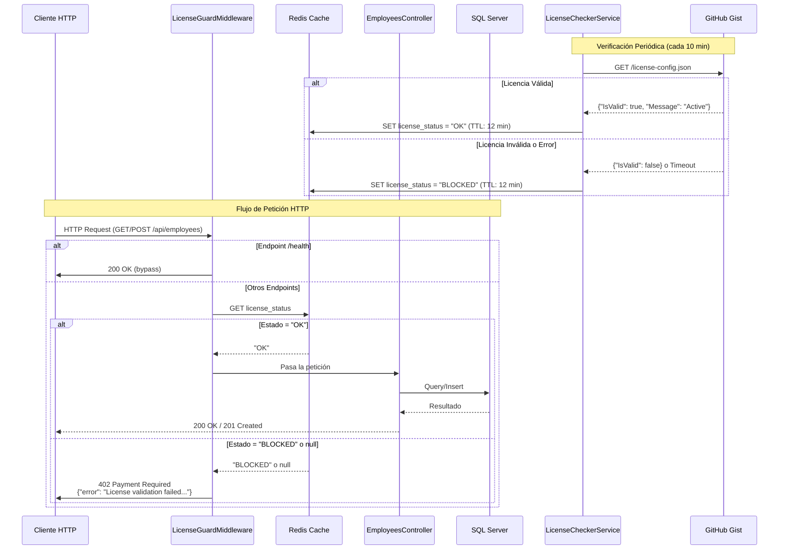

# FreelanceGuard ERP (Defensive REST API)

<p align="center"></p>

## Descripción

**FreelanceGuard ERP** es un sistema de gestión de empleados protegido por un mecanismo de validación remota de licencias. La API implementa un patrón **"Dead Man's Switch"** que bloquea automáticamente el acceso si no se detecta una licencia válida en un Gist de GitHub.

Este sistema está diseñado como una **API REST defensiva** que permite control remoto del acceso mediante validación de licencias almacenadas en un repositorio externo (GitHub Gist) y caché distribuido (Redis).

### Características Principales

- **Validación Remota de Licencias**: Verificación periódica de licencias desde GitHub Gist
- **Bloqueo Automático**: Sistema de protección que bloquea el acceso si la licencia es inválida
- **Caché Distribuido**: Uso de Redis para optimizar las verificaciones de licencia
- **Containerización Completa**: Infraestructura con Docker Compose para levantar todo en local
- **Gestión de Empleados**: API REST completa para operaciones CRUD de empleados

## Arquitectura

### Stack Tecnológico

- **Backend**: .NET 8 Web API
- **Base de Datos**: SQL Server 2022
- **Caché/Locking**: Redis (Alpine)
- **ORM**: Dapper (micro-ORM para acceso a datos)
- **Infraestructura**: Docker Compose
- **Cliente HTTP**: HttpClientFactory con Polly para resiliencia

### Componentes del Sistema

1. **LicenseCheckerService**: Servicio en segundo plano que verifica periódicamente el estado de la licencia desde GitHub Gist
2. **LicenseGuardMiddleware**: Middleware que intercepta todas las peticiones y valida el estado de la licencia en Redis
3. **EmployeeRepository**: Capa de acceso a datos usando Dapper y SQL Server
4. **EmployeesController**: Controlador REST para operaciones de empleados

## Diagrama de Flujo

El siguiente diagrama muestra el flujo completo del sistema de validación de licencias:



## Instalación y Uso

### Requisitos Previos

- **Docker** (versión 20.10 o superior)
- **Docker Compose** (versión 2.0 o superior)
- **Git** (para clonar el repositorio)

### Pasos de Instalación

1. **Clonar el repositorio**:
   ```bash
   git clone https://github.com/MaxAcosta-30/FreelanceGuard-ERP.git
   cd FreelanceGuard-ERP
   ```

2. **Configurar variables de entorno**:
   
   Edita el archivo `docker-compose.yml` y configura la variable `LICENSE_CHECK_URL` con la URL de tu Gist de GitHub:
   
   ```yaml
   environment:
     - LICENSE_CHECK_URL=https://gist.githubusercontent.com/USERNAME/GIST_ID/raw/license-config.json
     - LICENSE_CHECK_INTERVAL_MIN=10  # Intervalo en minutos (opcional, default: 10)
   ```

   **Formato del Gist JSON**:
   ```json
   {
     "IsValid": true,
     "Message": "License is active"
   }
   ```

3. **Construir y ejecutar los contenedores**:
   ```bash
   docker compose up --build
   ```

   Este comando:
   - Construye la imagen de la API .NET 8
   - Levanta SQL Server 2022
   - Levanta Redis
   - Inicializa la base de datos automáticamente
   - Inicia el servicio de verificación de licencias

4. **Verificar que el sistema está funcionando**:
   ```bash
   curl http://localhost:8080/health
   # Debe responder: "System OK"
   ```

### Configuración de Conexiones

Las siguientes variables de entorno se configuran automáticamente en `docker-compose.yml`:

- **SQL Server**: `ConnectionStrings__DefaultConnection`
- **Redis**: `ConnectionStrings__Redis`
- **Licencia**: `LICENSE_CHECK_URL` (requerida)
- **Intervalo de verificación**: `LICENSE_CHECK_INTERVAL_MIN` (opcional, default: 10 minutos)

## Endpoints de la API

### Health Check
```
GET /health
```
**Respuesta**: `200 OK` - "System OK"

### Empleados

#### Obtener todos los empleados
```
GET /api/employees
```
**Respuestas**:
- `200 OK`: Lista de empleados
- `402 Payment Required`: Licencia inválida o bloqueada

#### Crear un empleado
```
POST /api/employees
Content-Type: application/json

{
  "fullName": "Juan Pérez",
  "position": "Desarrollador Senior",
  "salary": 5000.00
}
```
**Respuestas**:
- `201 Created`: Empleado creado exitosamente
- `400 Bad Request`: Datos inválidos
- `402 Payment Required`: Licencia inválida o bloqueada

## Sistema de Licencias (DRM)

El sistema implementa un mecanismo de **Digital Rights Management (DRM)** que permite el control remoto del acceso a la API:

### Funcionamiento

1. **Verificación Periódica**: El `LicenseCheckerService` consulta el Gist de GitHub cada X minutos (configurable, default: 10 min).

2. **Caché en Redis**: El estado de la licencia se almacena en Redis con un TTL ligeramente mayor al intervalo de verificación para tolerar fallos de red momentáneos.

3. **Protección en Middleware**: El `LicenseGuardMiddleware` intercepta todas las peticiones (excepto `/health`) y verifica el estado en Redis antes de permitir el acceso.

4. **Comportamiento Fail-Secure**: Si la verificación de licencia falla o hay un timeout, el sistema asume el peor escenario y bloquea el acceso (HTTP 402).

### Estados de Licencia

- **"OK"**: Licencia válida, acceso permitido
- **"BLOCKED"**: Licencia inválida o error de conexión, acceso denegado
- **null/expired**: Si la clave expira o no existe, se trata como bloqueado

## Desarrollo

### Estructura del Proyecto

```
FreelanceGuard-ERP/
├── docker-compose.yml          # Orquestación de servicios
├── README.md                   # Este archivo
└── src/
    └── FreelanceGuard.Api/
        ├── Controllers/        # Controladores REST
        ├── Models/            # Modelos de dominio
        ├── Repositories/      # Capa de acceso a datos
        ├── Services/          # Servicios de negocio y background
        ├── Middleware/        # Middleware personalizado
        └── Program.cs         # Punto de entrada de la aplicación
```

### Tecnologías Utilizadas

- **Dapper**: Micro-ORM para acceso eficiente a SQL Server
- **StackExchange.Redis**: Cliente de alto rendimiento para Redis
- **Microsoft.Data.SqlClient**: Driver oficial de SQL Server para .NET
- **HttpClientFactory**: Gestión de clientes HTTP con Polly para resiliencia

## Notas Técnicas

- El sistema utiliza **file-scoped namespaces** (C# 10+)
- Todos los componentes están documentados con comentarios XML
- El middleware omite la validación de licencia para el endpoint `/health` para permitir monitoreo
- La inicialización de la base de datos se realiza automáticamente al iniciar el contenedor (solo para desarrollo/demo)

## Autor

**Max Acosta**

- GitHub: [@MaxAcosta-30](https://github.com/MaxAcosta-30)

## Licencia

Este proyecto es de código propietario. Todos los derechos reservados.

---

**Importante**: es un proyecto de portafolio, no un sistema en producción. Usa un mecanismo de validación remota de licencias: Asegúrate de configurar correctamente la URL del Gist y las credenciales de base de datos antes de desplegar.

